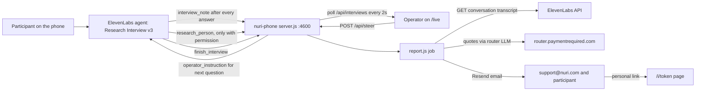

# phone-paymentrequired

Research interview hotline tool at **https://phone.paymentrequired.com**.
An ElevenLabs voice agent interviews a participant by phone. This service is its MCP server:
it stores a note per answer, hands live operator instructions to the agent, does consent-gated
public lookups, and after the call mails an own-words report (quotes, who they are, consent flags,
full transcript) to support@nuri.com and, if they left an email, to the participant.

Node 22, stdlib only, no dependencies.

## Flow



## Endpoints

| Path | Auth | What |
|---|---|---|
| `POST /mcp` | `Authorization: Bearer PHONE_MCP_TOKEN` | Streamable-HTTP MCP (JSON-RPC): `initialize`, `tools/list`, `tools/call` |
| `GET /mcp` | same bearer | tools/list sanity |
| `/phone-mcp` on support.nuri.com | same bearer | fallback URL to the same MCP |
| `GET /live` | `?token=PHONE_OPERATOR_TOKEN` once, then cookie | Live operator page |
| `GET /api/interviews` | operator token/cookie | Recent interviews with all lines |
| `POST /api/steer` `{conversation_id, text}` | operator token/cookie | Queue an instruction for the next `interview_note`; `conversation_id: "*"` = next active call |
| `GET /i/:token` | personal token | Participant's own interview |
| `GET /`, `/llms.txt`, `/healthz` | none | Landing, machine summary, health with git sha |

### MCP tools
- `interview_note {conversation_id, person_said, agent_summary?, phase}` -> `{operator_instruction, research}`. Instruction is consumed once.
- `research_person {conversation_id, consent, name?, company?, context?, url?, handle?}` -> `{research}` (<=110 words; 4 parallel searchers (identity, public voice, work, money) folded into match + facts + 3 hooks; runs async in ElevenLabs, result arrives on a later turn; web search via OpenRouter `perplexity/sonar` on name/company/context, plus GitHub API + website title/description). Refused unless `consent` is the boolean `true`.
- `finish_interview {conversation_id, email?, name?, may_attribute, consent_research}` -> stores flags, mints a personal token, runs the report 15 s later.

The agent passes `{{system__conversation_id}}` as `conversation_id`. Every tool call without an id matching `^conv_[a-z0-9]+$` is refused with `isError`; there is no fallback and no guessing of the conversation.

## Report

`node --env-file=.env report.js <conversation_id> [--to addr] [--print] [--force]`
Polls `GET /v1/convai/conversations/{id}` up to 3 min until done, asks the router LLM (`claude-sonnet-5-5`, fallbacks haiku and VOICE_LLM_UPSTREAM) for themes + quotes as JSON, keeps only quotes that occur verbatim in the participant's lines, strips U+2014, and mails with an idempotency key per conversation and recipient. `--to` sends only to that address. `--force` bypasses idempotency.

## Env (names only, values live in /opt/nuri-phone/.env, mode 600)

`PHONE_MCP_TOKEN`, `PHONE_OPERATOR_TOKEN`, `ELEVENLABS_API_KEY`, `RESEND_API_KEY`, `RESEND_FROM`, `RESEND_REPLY_TO`, `ROUTER_INTERNAL_KEY`, `VOICE_LLM_UPSTREAM_URL`, `VOICE_LLM_UPSTREAM_KEY`, `VOICE_LLM_UPSTREAM_MODEL`. Optional: `OPENROUTER_API_KEY` (web search in `research_person`; without it only GitHub/website lookups), `RESEARCH_MODEL` (default `google/gemini-2.5-flash:online`), `RESEARCH_SYNTH_MODEL` (default `openai/gpt-4.1-mini`), `PHONE_AGENT_ID` (enables the hang-up sweep: report for done calls over 20 s without `finish_interview`), `PHONE_PORT` (4600), `PHONE_DATA_DIR`, `REPORT_MODEL`, `REPORT_TO`, `PUBLIC_BASE_URL`.

State: one JSON-lines file per interview in `/opt/nuri-phone/data/` (dir mode 700). Steering queue is in memory.

## Deploy (box nuri-support, 167.233.218.237)

```sh
git clone https://github.com/nuri-com/phone-paymentrequired /opt/nuri-phone   # or: cd /opt/nuri-phone && git pull
cd /opt/nuri-phone && mkdir -p data && chmod 700 data
# .env once: grep the shared keys from /opt/nuri-support/.env, add two fresh tokens (openssl rand -hex 24), chmod 600
useradd --system --no-create-home --home-dir /nonexistent --shell /usr/sbin/nologin nuri-phone   # once
chown -R nuri-phone:nuri-phone data && chown nuri-phone:nuri-phone .env && chmod 600 .env
mkdir -p /usr/local/lib/nuri-phone && ln "$(readlink -f /usr/local/bin/node)" /usr/local/lib/nuri-phone/node   # node binary outside /root
cp deploy/nuri-phone.service /etc/systemd/system/ && systemctl daemon-reload && systemctl enable --now nuri-phone
# Caddy: add deploy/Caddyfile.snippet, then
caddy validate --config /etc/caddy/Caddyfile && systemctl reload caddy
curl -s https://phone.paymentrequired.com/healthz
```

ElevenLabs wiring (on the box, keys from .env):

```sh
node --env-file=.env scripts/el-register-mcp.mjs        # "Interview notes" MCP, auto_approve_all, tools readback
node --env-file=.env scripts/el-create-agent.mjs        # "Research Interview v3", clone of the test interviewer
node --env-file=.env scripts/el-simulate.mjs <agent_id> evidence
node --env-file=.env scripts/el-tool-modes.mjs            # research_person async, finish_interview immediate, speculative turn
node --env-file=.env scripts/el-ws-chat.mjs emin [llm]    # text chat over the real agent socket, runs real MCP tools, prints latency
```

If a real call fails with ElevenLabs error 3000 (agent flagged unsafe): `el-register-mcp.mjs --url https://support.nuri.com/phone-mcp --new`, then `el-create-agent.mjs --new`.

## Rollback

```sh
cd /opt/nuri-phone && git checkout <previous sha> && systemctl restart nuri-phone
```

## Security

- Runs as system user `nuri-phone` with `NoNewPrivileges`, `ProtectSystem=strict`, `ProtectHome`, `PrivateTmp`; only `/opt/nuri-phone/data` is writable. The repo stays root-owned.
- `research_person` fetches only `http`/`https` on ports 80/443. Every hop is resolved with DNS (all addresses) and refused if any address is loopback, private, link-local (incl. 169.254.169.254), CGNAT, ULA, multicast or reserved, for IPv4 and IPv6. The connection is pinned to the checked address, redirects are followed manually (max 3, each re-checked), bodies stop at 512 KB, timeout 8 s.
- `research_person` needs `consent: true` server-side; the prompt rule alone is not trusted.
- Tool calls need a real `conv_` id; reports are only built for that exact ElevenLabs conversation.
- Request bodies over 1 MB get `413` and the connection is closed. Bad JSON gets `400`.
- All responses carry `Strict-Transport-Security`, `Referrer-Policy: no-referrer`, `X-Content-Type-Options: nosniff`.

## Prompt

`prompt/interview-prompt.txt` is exactly what the agent uses. The `## TOOL RULES` block at the end is self-contained and can be pasted into other prompts.
